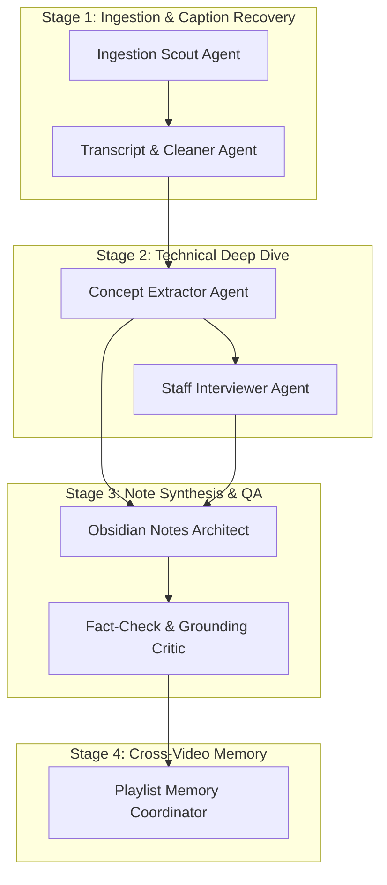

# Multi-Agent Architecture

NoteLoom V2 divides the interview preparation pipeline across **seven specialized agents**. Each agent possesses a specific persona, input schema, output schema, and validation criteria.

---

## Agent Roster

---

### 1. Ingestion Scout Agent
* **Role:** YouTube metadata researcher and playlist coordinator.
* **Responsibilities:**
  - Parses YouTube video or playlist links.
  - Extracts playlist hierarchy, video IDs, titles, descriptions, upload dates, durations, and chapters.
  - Passes structured tasks to the pipeline in deterministic order.
* **Outputs:** `VideoMetadata` or `PlaylistMetadata` payload.

---

### 2. Transcript & Cleaner Agent
* **Role:** Subtitle extractor, sanitizer, and fallback handler.
* **Responsibilities:**
  - Fetches auto-generated or manual subtitles via YouTube Transcript API.
  - **Fallback Handling:** If no transcript exists, it flags `transcript_available = False` and triggers the fallback note builder so the pipeline does not stop.
  - Sanitizes subtitle noise: removes timestamps, `[Music]`, `[Applause]`, deduplicates stuttered auto-caption lines.
  - Normalizes technical terminology (e.g., "cube netties" -> "Kubernetes", "post gres" -> "PostgreSQL").
* **Outputs:** Cleaned transcript string or `MissingTranscriptSignal`.

---

### 3. Concept Extractor Agent (Grounded Anchor)
* **Role:** Senior Computer Science Educator.
* **Responsibilities:**
  - Identifies 3 to 8 core technical concepts explained in the video.
  - For each concept:
    - Extracts the plain-language definition.
    - Captures the exact problem it solves ("Why it matters").
    - Traces the internal mechanism or steps ("How it works").
    - Grabs a **verbatim evidence snippet (6–50 words)** directly from the transcript to prevent hallucination.
    - Notes the instructor's real-world example (if given).
* **Outputs:** `VideoConcepts` artifact (strictly typed Pydantic model).

---

### 4. Staff Interviewer Agent
* **Role:** FAANG / Tier-1 Principal Bar Raiser.
* **Responsibilities:**
  - Analyzes the extracted concepts through an interview lens.
  - Generates:
    - **Screening Questions:** Fundamentals & 60-second answers.
    - **Deep-Dive / Under-the-Hood Questions:** "What happens when node X crashes during replication?", memory layout, lock contention, etc.
    - **Trade-Off Matrix:** Compare vs. alternatives (e.g., Latency vs. Throughput, Consistency vs. Availability).
    - **Candidate Red Flags / Common Traps:** The exact wrong answers candidates give that cause rejections.
* **Outputs:** `InterviewPrepPack` artifact.

---

### 5. Obsidian Notes Architect (Synthesis Agent)
* **Role:** Master Technical Writer and Obsidian Vault Designer.
* **Responsibilities:**
  - Merges outputs from the Concept Extractor and Staff Interviewer into a cohesive Markdown document.
  - Applies native Obsidian markdown formatting:
    - YAML metadata front matter.
    - Callout boxes (`> [!TIP]`, `> [!WARNING]`, `> [!NOTE]`).
    - Spaced-repetition flashcard format (`Question :: Answer` and `#flashcards`).
    - Flowcharts and architecture diagrams using Mermaid.
  - Generates a "60-Second Elevator Pitch" section.
* **Outputs:** Final Obsidian markdown file (`.md`).

---

### 6. Grounding & Anti-Hallucination Critic
* **Role:** Strict Quality Assurance Judge.
* **Responsibilities:**
  - Verifies that every concept attributed to the video is backed by genuine transcript evidence.
  - Ensures external interview extensions are clearly tagged as `[EXTRA]` or `[INTERVIEW-DRILL]`.
  - Checks for mathematical and technical correctness (Big-O complexities, API behavior).
  - Flags any missing sections or template violations before output is finalized.
* **Outputs:** Quality check verification report (Pass / Needs revision).

---

### 7. Playlist Memory & Curriculum Coordinator
* **Role:** Long-term memory manager across multi-video playlists.
* **Responsibilities:**
  - Tracks concepts across videos 1 through $N$.
  - Avoids re-explaining previously learned topics; instead creates Obsidian wikilinks:
    e.g., *"As covered in [[Day 02 - Database Indexing]], B+ Trees are used here..."*
  - Incrementally updates a cumulative `GLOSSARY.md` (all defined terms) and `ROADMAP.md` (curriculum table of contents).
* **Outputs:** Updated `GLOSSARY.md`, `ROADMAP.md`, and cross-note wikilinks.

