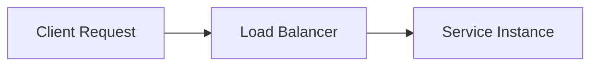

# Interview-Ready Obsidian Note Template

NoteLoom V2 produces clean, structured Markdown files optimized for **Obsidian**, equipped with callouts, wikilinks, code blocks, and spaced-repetition flashcards.

---

## 1. Standard Interview Note Template

Below is the standard layout generated for any video with an available transcript:

````markdown
---
video_id: "<YOUTUBE_ID>"
video_title: "<TITLE>"
channel: "<CHANNEL_NAME>"
day_number: 1
tags:
  - interview-prep
  - software-engineering
  - system-design
  - dsa
created_at: 2026-10-23
source_url: "https://www.youtube.com/watch?v=<YOUTUBE_ID>"
---

# <Title>

> [!NOTE] 60-Second Elevator Pitch
> **If an interviewer asks "What is X and why does it matter?":**
> <Crisp 2-3 sentence definition explaining the problem, the core mechanism, and the real-world standard use case.>

---

## 🗺️ The Big Picture
- **Where this fits:** <How this fits into the broader software architecture or algorithm design>
- **Prerequisites:** [[Prerequisite Topic]]
- **Leads To:** [[Next Topic]]

---

## ⚙️ Core Technical Concepts & Deep Dives

### 1. <Concept Name>
- **In Plain English:** <Clear, jargon-free explanation>
- **Why It Matters:** <The pain point or engineering problem it solves>
- **How It Works Under the Hood:**
  1. Step 1: <Internal mechanism>
  2. Step 2: <Internal mechanism>
  3. Step 3: <Internal mechanism>
- **Instructor's Real-World Example:** <Example given in the video, or "None">
- **Transcript Evidence Snippet:**
  > "<Verbatim 6-50 word quote from video transcript grounding this concept>"



---

## ⚖️ Trade-Off Matrix & Comparisons (Crucial for Interviews)

| Solution / Approach | Key Advantages | Major Bottlenecks / Downsides | Best Used When... |
| :--- | :--- | :--- | :--- |
| **This Approach** | High throughput, sub-ms reads | Memory intensive, eventual consistency | Read-heavy workloads |
| **Alternative Approach** | ACID guarantees, zero data loss | Lower write throughput, scaling complexity | Financial transactions |

---

## ⚠️ Common Candidate Traps & Red Flags
> [!DANGER] Common Interview Mistakes
> - **Mistake 1:** Candidates frequently confuse latency with throughput when discussing this topic.
> - **Mistake 2:** Forgetting to mention the network split / partition tolerance scenario in distributed setups.
> - **Red Flag:** Assuming memory is unlimited or not mentioning cache eviction policies.

---

## 🎯 Mock Interview Question Bank

### Level 1: Screening & Fundamentals
- **Q:** Explain how <Concept> works to a junior developer.
  - **Model Answer:** ...

### Level 2: Under-the-Hood Mechanics
- **Q:** What happens internally when <Condition / Edge Case / Crash> occurs?
  - **Model Answer:** ...

### Level 3: System Design / Applied Scenario
- **Q:** How would you scale <System> to handle 100,000 writes/sec using this concept?
  - **Model Answer:** ...

---

## ⚡ Quick-Reference Cheat Sheet
- **Time Complexity:** $O(1)$ lookup, $O(\log N)$ insert
- **Space Complexity:** $O(N)$
- **Key Metric / Formula:** ...
- **Default Production Parameters:** ...

---

## 📇 Spaced-Repetition Flashcards (`#flashcards`)

What problem does <Concept> solve? #flashcards
?
It solves <Problem> by providing <Mechanism>.

When should you NOT use <Concept>? #flashcards
?
Avoid using it when <Constraint / Bottleneck>, because <Reason>.

---

## 🔗 Related Topics & Cross References
- [[Day 01 - Foundations]]
- [[Distributed Caching Architecture]]
- [[Database Sharding Strategies]]
````

---

## 2. Fallback Note Template (Transcript Not Available)

When a video has disabled or unavailable captions, NoteLoom V2 creates this fallback note so the playlist sequence remains uninterrupted:

````markdown
---
video_id: "<YOUTUBE_ID>"
video_title: "<TITLE>"
channel: "<CHANNEL_NAME>"
day_number: 3
status: transcript_unavailable
tags:
  - interview-prep
  - manual-notes-needed
source_url: "https://www.youtube.com/watch?v=<YOUTUBE_ID>"
---

# <Title>

> [!WARNING] Transcript Not Available
> Automatic captions and transcripts could not be retrieved for this video from YouTube.
> The video was preserved in the playlist sequence. You can take manual notes below or attach a custom transcript file.

- **Video URL:** [<Title>](https://www.youtube.com/watch?v=<YOUTUBE_ID>)
- **Channel:** <Channel Name>
- **Duration:** <MM:SS>

---

## 📝 Manual Notes & Interview Highlights
<!-- Add your manual study notes, key takeaways, and interview questions below -->

### Key Takeaways
- [ ] 

### Interview Questions to Remember
- [ ] 

### Trade-offs / Code Examples
```

```
````

