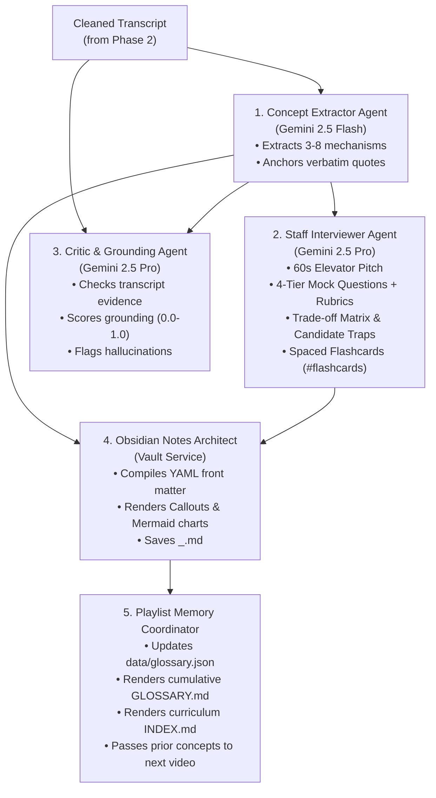

# Phase 3 Guide: Multi-Agent Intelligence & Memory

> This document explains how the **Multi-Agent Intelligence Core** built in **Phase 3** operates, how each agent uses Gemini with strictly typed schemas, and how persistent memory across playlists is handled.

---

## 1. Phase 3 Architecture Overview

---

## 2. The Multi-Agent Intelligence Core: File by File

### 🔹 `backend/app/services/gemini_service.py` (Structured SDK Wrapper)
- Interacts with Google's latest `google-genai` Python SDK.
- Uses `types.GenerateContentConfig(response_mime_type="application/json", response_schema=...)`.
- Guarantees that Gemini returns **100% strictly validated Pydantic models**, eliminating manual JSON parsing errors or unpredictable markdown formats.

---

### 🔹 `backend/app/agents/concept_extractor_agent.py` (Grounded Core Extraction)
- **Model:** `gemini-2.5-flash` (fast, deterministic extraction at low temperature `0.2`).
- **Core Mission:**
  1. Identifies 3 to 8 primary technical concepts taught in the video.
  2. For every concept, captures:
     - `one_line`: Plain-English explanation.
     - `why_it_matters`: The engineering problem or bottleneck it solves.
     - `how_it_works`: Step-by-step internal mechanisms (tagged with `is_extra=False` or `True`).
     - `evidence_snippet`: **A verbatim 6-to-50 word quote from the transcript** that anchors the concept directly in the speaker's words.
     - `instructor_example`: Concrete scenario or code walkthrough demonstrated by the instructor.
- **Pipeline Authority:** Overrides any LLM-guessed `video_id`, `video_title`, or `day_number` with the deterministic metadata from the Ingestion Agent.

---

### 🔹 `backend/app/agents/interviewer_agent.py` (FAANG Bar-Raiser)
- **Model:** `gemini-2.5-pro` (high-reasoning model at temperature `0.4`).
- **Core Mission:** Analyzes technical concepts through the lens of a Tier-1 tech interviewer.
  1. **60-Second Elevator Pitch:** Answers *"What is X and why does it matter?"* crisply so candidates can say it verbally in a screen.
  2. **4-Tier Interview Questions:**
     - `SCREENING`: Fast conceptual checks (e.g. "Explain the difference between TCP and UDP in 30 seconds").
     - `UNDER_THE_HOOD`: Deep-dive internal mechanics, failure modes, concurrency, memory layout (e.g. "What happens when a Raft follower misses two heartbeats?").
     - `SYSTEM_DESIGN`: Real-world architectural scenarios and scaling.
     - `TRADEOFF`: Comparing X vs Y (e.g. "B+ Tree vs LSM-Tree for write-heavy workloads").
  3. **Interviewer Rubric:** Tells the candidate what specific architectural choices, terms, and signals bar-raisers look for.
  4. **Candidate Traps & Red Flags:** The most frequent wrong assumptions or misconceptions that cause rejections.
  5. **Trade-Off Matrix:** Structured table of Advantages, Bottlenecks, Best used when, and Avoid when.
  6. **Active-Recall Flashcards:** Single-concept Q&A cards in Obsidian format (`#flashcards`).

---

### 🔹 `backend/app/agents/critic_agent.py` (Fact-Checking & Anti-Hallucination)
- **Model:** `gemini-2.5-pro` (temperature `0.1`).
- **Core Mission:**
  1. Checks whether evidence snippets actually exist in the transcript.
  2. Audits whether mechanisms explained by the extractor accurately reflect the speaker's claims.
  3. Returns a `GroundingCheckResult(passed=True/False, score=0.0-1.0, feedback=...)`.
  4. Emits warning events if unbacked claims or hallucinations are detected.

---

### 🔹 `backend/app/agents/writer_agent.py` (Obsidian Notes Architect)
- Assembles the extracted concepts, trade-off matrix, interviewer Q&A, and cheat sheets into the final Obsidian study guide.
- Formats native Obsidian callout blocks (`> [!NOTE]`, `> [!DANGER]`, `> [!WARNING]`).
- Writes the note directly into `notes_vault/<Day>_<slug>.md`.

---

### 🔹 `backend/app/agents/memory_agent.py` (Cross-Video Memory Coordinator)
For multi-video playlists, interview candidates need a connected curriculum rather than isolated notes:
1. **Persistent Glossary:** Maintains `data/glossary.json`. When a concept is introduced in Day 1 and mentioned again in Day 3, it records cross-references.
2. **`notes_vault/GLOSSARY.md`:** Generates an alphabetical master glossary linking every concept to the video where it was first taught and where it was referenced.
3. **`notes_vault/INDEX.md`:** Generates a clean curriculum roadmap linking to each day's study note (`[[01_raft-consensus-algorithm-explained]]`) and displaying status badges (`✅ Interview Ready` vs `⚠️ Transcript Missing`).
4. **Context Passing:** Passes previously accumulated concepts to subsequent videos so downstream agents can create wikilinks instead of re-explaining old concepts from scratch.

---

### 🔹 `backend/app/orchestrator.py` (The Central Nervous System)
- Unifies all 7 agents into an asynchronous execution flow (`PipelineOrchestrator.process_url`).
- Supports a real-time event dispatcher callback (`event_callback`) that yields `JobEvent` updates at every stage.
- Handles both successful transcript pipelines and missing-transcript fallback routes seamlessly without interrupting playlist execution.

---

## 3. How Phase 3 Was Tested

In [`backend/tests/test_phase3.py`](file:///c:/Users/dhruv/Dev/noteloomV2/backend/tests/test_phase3.py), we verified:
1. **`test_writer_agent_generates_markdown`**: Verified that full Obsidian notes are created with callouts, front matter, elevator pitch, and flashcards.
2. **`test_playlist_memory_agent`**: Verified that `data/glossary.json`, `notes_vault/GLOSSARY.md`, and `notes_vault/INDEX.md` are accurately generated and cross-linked.
3. **`test_critic_agent_heuristic_check`**: Verified that the critic evaluates grounding against transcript text.
4. **`test_orchestrator_handles_missing_transcript`**: Verified end-to-end async orchestration with fallback note creation and index rendering.

**Result: 8/8 tests pass in < 1 second.**

