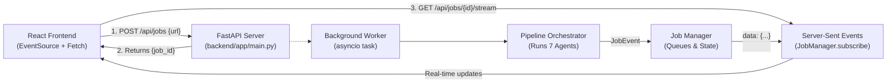

# Phase 4 Guide: FastAPI Server & Real-Time SSE Streaming

> This document details the **FastAPI Web Server**, the **Job Manager**, and the **Server-Sent Events (SSE)** real-time streaming engine built in **Phase 4**.

---

## 1. System Architecture: The API Layer



---

## 2. API Endpoints Reference

### 🟢 1. Health & Configuration Check
* **`GET /api/health`**
* **Response:**
  ```json
  {
    "status": "online",
    "version": "2.0.0",
    "gemini_configured": true,
    "models": {
      "extractor": "gemini-2.5-flash",
      "interviewer": "gemini-2.5-pro",
      "writer": "gemini-2.5-flash",
      "critic": "gemini-2.5-pro"
    },
    "vault_dir": "C:\\Users\\...\\noteloomV2\\notes_vault"
  }
  ```

---

### 🟢 2. Start Processing Job
* **`POST /api/jobs`**
* **Request Body:**
  ```json
  {
    "url": "https://www.youtube.com/playlist?list=PL..."
  }
  ```
* **Response (Immediate):**
  ```json
  {
    "job_id": "job_98b7f21a",
    "status": "pending",
    "url": "https://www.youtube.com/playlist?list=PL..."
  }
  ```
* **Behavior:** Spawns an asynchronous background task (`run_pipeline_worker`) and immediately returns a unique `job_id`.

---

### 🟢 3. Real-Time Server-Sent Events (SSE) Stream
* **`GET /api/jobs/{job_id}/stream`**
* **Headers returned:**
  - `Content-Type: text/event-stream`
  - `Cache-Control: no-cache`
  - `Connection: keep-alive`
* **Stream Payload Format:**
  ```
  data: {"job_id":"job_98b7f21a","step":"ingestion","agent_name":"Ingestion Scout Agent","status":"completed","message":"Detected playlist 'Distributed Systems' with 5 videos.","timestamp":"2026-10-23T04:20:00Z"}

  data: {"job_id":"job_98b7f21a","step":"concepts","agent_name":"Concept Extractor Agent","status":"processing","message":"Extracting grounded technical concepts & evidence from 'Day 1: Raft'..."}
  ```
* **Replay Feature:** When a client reconnects or opens the stream after processing has started, `JobManager` replays all previous events in sequence before streaming live events.
* **Keep-Alive:** Sends periodic `: ping\n\n` comments every 15 seconds to prevent browser or proxy disconnects during longer LLM passes.

---

### 🟢 4. Check Job Status
* **`GET /api/jobs/{job_id}`**
* **Response:** Full `JobState` object containing status (`processing`, `completed`, or `failed`), all events, generated note paths, and error messages (if any).

---

### 🟢 5. List Vault Notes
* **`GET /api/notes`**
* **Response:**
  ```json
  [
    {
      "filename": "01_raft-consensus-algorithm-explained.md",
      "stem": "01_raft-consensus-algorithm-explained",
      "is_index_or_glossary": false,
      "size_bytes": 4812
    },
    {
      "filename": "INDEX.md",
      "stem": "INDEX",
      "is_index_or_glossary": true,
      "size_bytes": 1024
    }
  ]
  ```

---

### 🟢 6. Read Note Content
* **`GET /api/notes/{filename}`**
* **Response:**
  ```json
  {
    "filename": "01_raft-consensus-algorithm-explained.md",
    "content": "---\nvideo_id: \"...\"\n...\n# Day 01: Raft..."
  }
  ```

---

### 🟢 7. Download Obsidian Vault as ZIP
* **`GET /api/download/vault`**
* **Response:** Binary ZIP archive containing all markdown notes, `INDEX.md`, and `GLOSSARY.md` ready to drag-and-drop into Obsidian!

---

## 3. How to Run the Server Locally

From the root directory:
```powershell
.\.venv\Scripts\uvicorn backend.app.main:app --reload --port 8000
```
Interactive API documentation will be available at:
- Swagger UI: `http://localhost:8000/docs`
- ReDoc: `http://localhost:8000/redoc`

