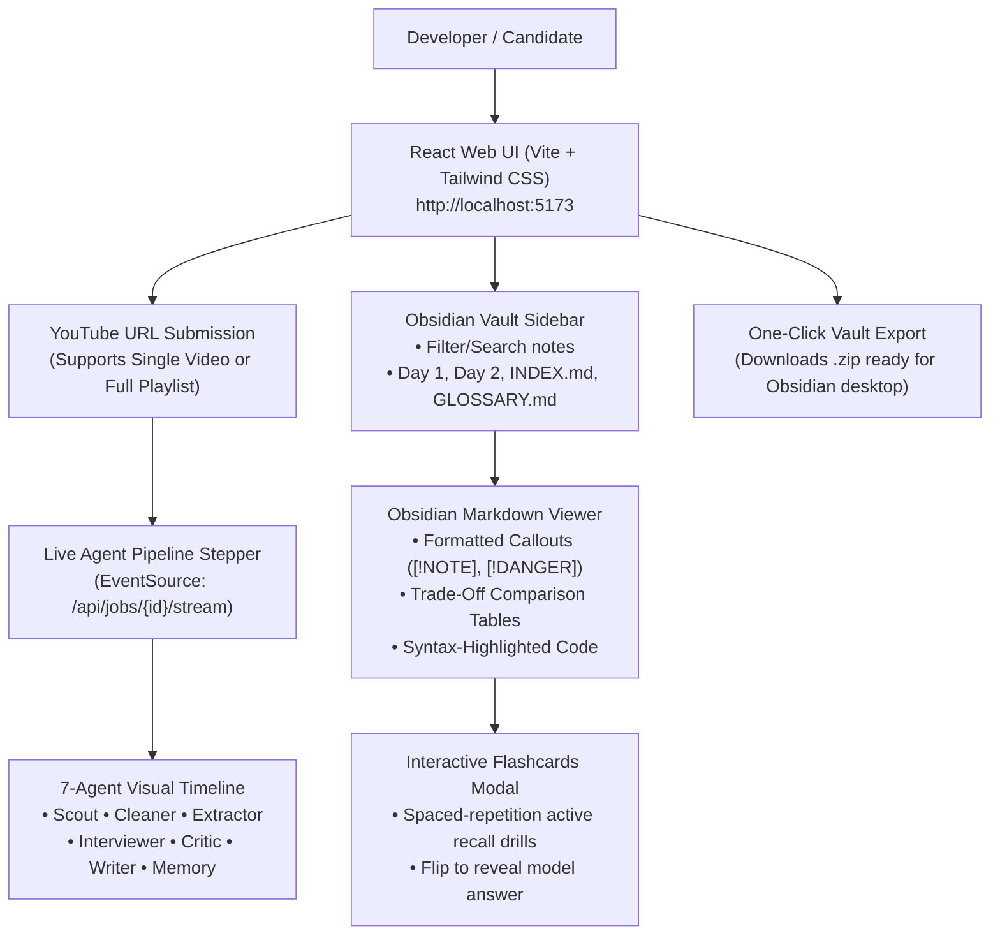

# Phase 5 Guide: React Frontend & Interactive Obsidian Viewer

> This document details the **React Frontend Web UI**, the **Live Multi-Agent Stepper**, and the **Interactive Obsidian Markdown & Flashcard Viewer** built in **Phase 5**.

---

## 1. Frontend Architecture Overview



---

## 2. Component Structure

| Component | File Path | Role |
| :--- | :--- | :--- |
| **`Header`** | `src/components/Header.jsx` | App branding, FastAPI backend live connectivity indicator, and "Export Vault (.zip)" button. |
| **`AgentStepper`** | `src/components/AgentStepper.jsx` | Visual timeline of the 7 agents with active spinners, completed checks, and a live terminal log box showing SSE event messages in real time. |
| **`VaultSidebar`** | `src/components/VaultSidebar.jsx` | Lists notes in the Obsidian vault with instantaneous search/filter and refresh capabilities. |
| **`NoteViewer`** | `src/components/NoteViewer.jsx` | Renders Obsidian-compatible Markdown with custom callout blocks (`[!NOTE]`, `[!WARNING]`, `[!DANGER]`), code styling, copy-to-clipboard, and flashcard triggers. |
| **`FlashcardModal`** | `src/components/FlashcardModal.jsx` | Full-screen interactive flip-card study mode for rapid-fire technical interview questions. |
| **`App`** | `src/App.jsx` | Main state controller managing URL submission, Server-Sent Events, note loading, and layout. |

---

## 3. How to Run the Frontend

### Step 1: Ensure Backend is Running
In your backend terminal (PowerShell):
```powershell
.\.venv\Scripts\uvicorn backend.app.main:app --reload
```
*(Running on `http://localhost:8000`)*

---

### Step 2: Start the React Frontend
Open another terminal in `C:\Users\dhruv\Dev\noteloomV2\frontend` and run:

```powershell
npm run dev
```

Your React app will start at:
👉 **`http://localhost:5173`**

---

## 4. Key Frontend Features

1. **Vite Proxy Integration:**  
   Calls to `/api/*` are automatically proxied to `http://127.0.0.1:8000` via `vite.config.js`, preventing CORS issues.
2. **Real-Time Stream Resilience:**  
   The `EventSource` subscriber handles streaming errors, replays past events on reconnect, and automatically refreshes the vault sidebar when the orchestrator emits the `done` event.
3. **Obsidian Callout Translation:**  
   Standard markdown parsers ignore Obsidian callouts. NoteLoom V2's custom blockquote parser intercepts `> [!NOTE]`, `> [!WARNING]`, and `> [!DANGER]` tags and styles them into native Obsidian callout cards.
4. **Active-Recall Study Mode:**  
   Parses flashcard syntax (`#flashcards ? Answer`) directly from the markdown content and opens an interactive card deck with flip, next, and previous controls.

