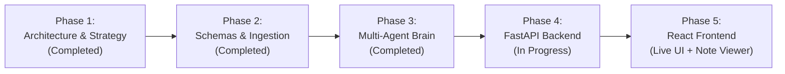

# NoteLoom V2: Project Status & Roadmap

> **Current Status:** 🟢 **Phase 3 Complete (Multi-Agent Intelligence Core & Memory Verified)**  
> **Next Step:** 🚀 **Phase 4 Implementation (FastAPI Server, Background Jobs & Real-Time SSE Stream)**

---

## 📍 Where Are We Right Now?

- [x] **Phase 1 (Architecture & Strategy):** System blueprint, 7-agent roster, interview templates, fallback specifications, and tech stack chosen.
- [x] **Phase 2 (Schemas, Ingestion & Fallback Engine):** Pydantic models, YouTube metadata extraction, caption cleaner, fallback note renderer, and test suite.
- [x] **Phase 3 (Multi-Agent Intelligence Core & Memory):**
  - [x] Created `GeminiService` wrapping the official `google-genai` SDK with strict JSON schema enforcement.
  - [x] Created `ConceptExtractorAgent` (`gemini-2.5-flash`) for grounded technical concept extraction with verbatim evidence snippets.
  - [x] Created `InterviewerAgent` (`gemini-2.5-pro`) for FAANG 4-tier Q&A, interviewer rubrics, trade-off matrices, candidate red flags, cheat sheets, and flashcards.
  - [x] Created `CriticAgent` (`gemini-2.5-pro`) for groundedness scoring, evidence verification, and anti-hallucination audits.
  - [x] Created `WriterAgent` for synthesizing notes with Obsidian callouts, code blocks, and `#flashcards`.
  - [x] Created `PlaylistMemoryAgent` for cross-video concept tracking, persistent `data/glossary.json`, `INDEX.md`, and `GLOSSARY.md`.
  - [x] Created `PipelineOrchestrator` linking all 7 agents into an end-to-end async pipeline with live event dispatching.
  - [x] Added automated integration tests (`backend/tests/test_phase3.py`) — **8/8 unit and integration tests passing**.
  - [x] Added `docs/06_PHASE3_AGENTS_GUIDE.md`.

---

## 🗺️ Project Milestones & Roadmap

### Phase 1: Architecture & Knowledge Base (Done)
- [x] `docs/01_PROJECT_OVERVIEW.md` - Strategy, domains, and core problem.
- [x] `docs/02_MULTI_AGENT_ARCHITECTURE.md` - Agent specifications and lifecycle.
- [x] `docs/03_INTERVIEW_NOTE_TEMPLATE.md` - Full Obsidian template and fallback rules.
- [x] `docs/04_SYSTEM_WORKFLOW_AND_STACK.md` - API endpoints, streaming, and data flow.
- [x] `docs/05_BACKEND_WORKING_GUIDE.md` - Plain-language walkthrough of Phase 2 backend.
- [x] `docs/06_PHASE3_AGENTS_GUIDE.md` - Plain-language guide to Phase 3 agents & memory.
- [x] `docs/PROJECT_STATUS.md` - Live status log.

### Phase 2: Schemas & Ingestion Engine (Done)
- [x] Set up Python environment and `requirements.txt`.
- [x] Define Pydantic v2 schemas (`VideoItem`, `TranscriptData`, `VideoConcepts`, `InterviewPrepPack`, `RenderedNote`, `JobEvent`).
- [x] Implement **Ingestion Agent** (YouTube URL parser, playlist expansion).
- [x] Implement **Transcript & Cleaner Agent** (caption fetching with missing-caption fallback).
- [x] Implement **Vault Service** (generates Obsidian notes and fallback notes).
- [x] Add automated unit tests (`backend/tests/test_phase2.py`).

### Phase 3: Multi-Agent Intelligence Core (Done)
- [x] Implement `GeminiService` using `google-genai` SDK with structured outputs (`response_schema`).
- [x] Implement **Concept Extractor Agent** with strict transcript grounding & verbatim evidence.
- [x] Implement **Staff Interviewer Agent** (FAANG questions, trade-offs, candidate red flags).
- [x] Implement **Critic Agent** (grounding audit & hallucination checks).
- [x] Implement **Writer Agent** (renders structured interview notes + `#flashcards`).
- [x] Implement **Playlist Memory Agent** (cross-linking, `INDEX.md`, and cumulative `GLOSSARY.md`).
- [x] Implement **Pipeline Orchestrator** (asynchronous end-to-end multi-agent execution loop).
- [x] Automated integration testing (`backend/tests/test_phase3.py`).

### Phase 4: FastAPI Server & Real-Time Streaming (Next)
- [ ] Build FastAPI server (`backend/app/main.py`) with asynchronous background task runner.
- [ ] Implement Server-Sent Events (SSE) `/api/jobs/{id}/stream` for live agent step streaming.
- [ ] Implement notes management endpoints (`GET /api/notes`, `GET /api/notes/{filename}`, `GET /api/download`).

### Phase 5: React Web UI
- [ ] Scaffold Vite + React + Tailwind frontend.
- [ ] Build YouTube URL submission & options form.
- [ ] Build live agent pipeline visualization (stepper showing which agent is working).
- [ ] Build Obsidian-like Markdown Viewer with syntax highlighting and flashcard mode.

