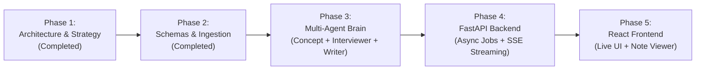

# NoteLoom V2: Project Status & Roadmap

> **Current Status:** 🟢 **Phase 2 Complete (Ingestion, Schemas & Fallback Engine Verified)**  
> **Next Step:** 🚀 **Phase 3 Implementation (Multi-Agent Brain: Concept + Interviewer + Writer + Gemini Client)**

---

## 📍 Where Are We Right Now?

- [x] **Phase 1 (Architecture & Strategy):** System blueprint, 7-agent roster, interview templates, fallback specifications, and tech stack chosen.
- [x] **Phase 2 (Schemas, Ingestion & Fallback Engine):**
  - [x] Initialized Python environment (`.venv`) with Python 3.14 + `fastapi`, `pydantic v2`, `google-genai`, `youtube-transcript-api`, `yt-dlp`.
  - [x] Created `backend/app/schemas.py`: strictly typed models for `VideoItem`, `IngestionResult`, `TranscriptData`, `VideoConcepts`, `InterviewPrepPack`, `RenderedNote`, and `JobEvent`.
  - [x] Created `backend/app/config.py`: dynamic configuration with `.env` loader.
  - [x] Created `backend/app/services/youtube_service.py`: URL parser, metadata extractor (single & playlist), caption fetcher, and subtitle noise cleaner.
  - [x] Created `backend/app/services/vault_service.py`: Obsidian Markdown renderer with callouts, front matter, and missing-transcript fallback note generator.
  - [x] Created `backend/app/agents/ingestion_agent.py` & `transcript_agent.py`: agent workflows with real-time streaming event generation.
  - [x] Verified Phase 2 with automated pytest suite (`4/4 tests passed`).

---

## 🗺️ Project Milestones & Roadmap

### Phase 1: Architecture & Knowledge Base (Done)
- [x] `docs/01_PROJECT_OVERVIEW.md` - Strategy, domains, and core problem.
- [x] `docs/02_MULTI_AGENT_ARCHITECTURE.md` - Agent specifications and lifecycle.
- [x] `docs/03_INTERVIEW_NOTE_TEMPLATE.md` - Full Obsidian template and fallback rules.
- [x] `docs/04_SYSTEM_WORKFLOW_AND_STACK.md` - API endpoints, streaming, and data flow.
- [x] `docs/05_BACKEND_WORKING_GUIDE.md` - Plain-language walkthrough of backend code & execution.
- [x] `docs/PROJECT_STATUS.md` - Live status log.

### Phase 2: Schemas & Ingestion Engine (Done)
- [x] Set up Python environment and `requirements.txt`.
- [x] Define Pydantic v2 schemas (`VideoItem`, `TranscriptData`, `VideoConcepts`, `InterviewPrepPack`, `RenderedNote`, `JobEvent`).
- [x] Implement **Ingestion Agent** (YouTube URL parser, playlist expansion).
- [x] Implement **Transcript & Cleaner Agent** (caption fetching with missing-caption fallback).
- [x] Implement **Vault Service** (generates Obsidian notes and fallback notes).
- [x] Add automated unit tests (`backend/tests/test_phase2.py`).

### Phase 3: Multi-Agent Intelligence Core (Next)
- [ ] Implement Gemini client service (`gemini-2.5-flash` and `gemini-2.5-pro` via `google-genai`).
- [ ] Implement **Concept Extractor Agent** with strict transcript grounding & verbatim evidence.
- [ ] Implement **Staff Interviewer Agent** (FAANG questions, trade-offs, candidate red flags).
- [ ] Implement **Writer Agent** (renders structured interview notes + `#flashcards`).
- [ ] Implement **Critic Agent** (grounding audit & tag external extensions).
- [ ] Implement **Playlist Memory** (cross-linking and cumulative `GLOSSARY.md`).

### Phase 4: FastAPI Server & Real-Time Streaming
- [ ] Build FastAPI server with asynchronous background workers.
- [ ] Implement Server-Sent Events (SSE) `/api/jobs/{id}/stream` for live agent updates.
- [ ] Implement notes management endpoints (`/api/notes`, `/api/download`).

### Phase 5: React Web UI
- [ ] Scaffold Vite + React + Tailwind frontend.
- [ ] Build YouTube URL submission & options form.
- [ ] Build live agent pipeline visualization (stepper showing which agent is working).
- [ ] Build Obsidian-like Markdown Viewer with syntax highlighting and flashcard mode.

