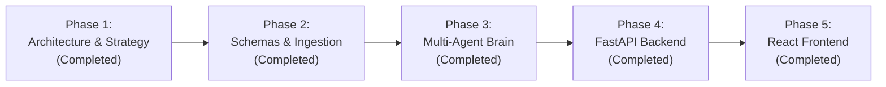

# NoteLoom V2: Project Status & Roadmap

> **Current Status:** 🟢 **Phase 5 Complete (Full-Stack NoteLoom V2 Ready!)**  
> **Next Step:** 🚀 **End-to-End Application Launch & Usage**

---

## 📍 Where Are We Right Now?

- [x] **Phase 1 (Architecture & Strategy):** System blueprint, 7-agent roster, interview templates, fallback specifications, and tech stack chosen.
- [x] **Phase 2 (Schemas, Ingestion & Fallback Engine):** Pydantic models, YouTube metadata extraction, caption cleaner, fallback note renderer, and test suite.
- [x] **Phase 3 (Multi-Agent Intelligence Core & Memory):** Gemini structured SDK integration, Concept Extractor, Staff Interviewer, Critic, Writer, and Playlist Memory agents.
- [x] **Phase 4 (FastAPI Server & Real-Time Streaming):** FastAPI application with background workers, SSE streaming (`/api/jobs/{id}/stream`), vault management, and 14 passing automated tests.
- [x] **Phase 5 (React Frontend Web UI):**
  - [x] Scaffolded modern React app using Vite & Tailwind CSS in `frontend/`.
  - [x] Created `Header` with live FastAPI health status and "Export Vault (.zip)" button.
  - [x] Created `AgentStepper`: 5-agent visual timeline with animated spinner and real-time SSE feed.
  - [x] Created `VaultSidebar`: instant search & filter for generated Obsidian notes.
  - [x] Created `NoteViewer`: renders Obsidian notes with native callouts, code syntax, and interactive flashcard integration.
  - [x] Built interactive Active-Recall Flashcard modal supporting both `#flashcards` and inline Q&As.
  - [x] **Adopted Concise Teacher Note Blueprint:** 1–2 pages, analogy-first, 4–8 concepts max, concept-coupled interview Q&As, concept flow, minimal code with WHY comments, and summary/doubts/task footer.
  - [x] **Enforced Additional Teacher Guardrails:**
    - Explicit attribution: WHO does the work (LLM vs. code) & exact data flow.
    - Complete minimal working code loop with exact matching numbers and WHY comments.
    - Production & safety gotchas for every concept.
    - Strict `(Extra)` tagging on all unmentioned points.
  - [x] Verified end-to-end generation and 15/15 passing unit tests.
  - [x] Added `docs/08_REACT_FRONTEND_GUIDE.md`.

---

## 🗺️ Project Milestones & Roadmap

### Phase 1: Architecture & Knowledge Base (Done)
- [x] `docs/01_PROJECT_OVERVIEW.md` - Strategy, domains, and core problem.
- [x] `docs/02_MULTI_AGENT_ARCHITECTURE.md` - Agent specifications and lifecycle.
- [x] `docs/03_INTERVIEW_NOTE_TEMPLATE.md` - Full Obsidian template and fallback rules.
- [x] `docs/04_SYSTEM_WORKFLOW_AND_STACK.md` - API endpoints, streaming, and data flow.
- [x] `docs/05_BACKEND_WORKING_GUIDE.md` - Plain-language walkthrough of Phase 2 backend.
- [x] `docs/06_PHASE3_AGENTS_GUIDE.md` - Plain-language guide to Phase 3 agents & memory.
- [x] `docs/07_FASTAPI_BACKEND_GUIDE.md` - FastAPI server, SSE stream, and REST endpoints.
- [x] `docs/08_REACT_FRONTEND_GUIDE.md` - React UI, live agent stepper & flashcards.
- [x] `docs/PROJECT_STATUS.md` - Live status log.

### Phase 2: Schemas & Ingestion Engine (Done)
- [x] Set up Python environment and `requirements.txt`.
- [x] Define Pydantic v2 schemas (`VideoItem`, `TranscriptData`, `VideoConcepts`, `InterviewPrepPack`, `RenderedNote`, `JobEvent`).
- [x] Implement **Ingestion Agent** (YouTube URL parser, playlist expansion).
- [x] Implement **Transcript & Cleaner Agent** (caption fetching with missing-caption fallback).
- [x] Implement **Vault Service** (generates Obsidian notes and fallback notes).
- [x] Add automated unit tests (`backend/tests/test_phase2.py`).

### Phase 3: Multi-Agent Intelligence Core (Done)
- [x] Implement `GeminiService` using `google-genai` SDK with structured outputs (`response_schema`).
- [x] Implement **Concept Extractor Agent** with strict transcript grounding & verbatim evidence.
- [x] Implement **Staff Interviewer Agent** (FAANG questions, trade-offs, candidate red flags).
- [x] Implement **Critic Agent** (grounding audit & hallucination checks).
- [x] Implement **Writer Agent** (renders structured interview notes + `#flashcards`).
- [x] Implement **Playlist Memory Agent** (cross-linking, `INDEX.md`, and cumulative `GLOSSARY.md`).
- [x] Implement **Pipeline Orchestrator** (asynchronous end-to-end multi-agent execution loop).
- [x] Automated integration testing (`backend/tests/test_phase3.py`).

### Phase 4: FastAPI Server & Real-Time Streaming (Done)
- [x] Build FastAPI server (`backend/app/main.py`) with asynchronous background task runner.
- [x] Implement Server-Sent Events (SSE) `/api/jobs/{id}/stream` for live agent step streaming.
- [x] Implement notes management endpoints (`GET /api/notes`, `GET /api/notes/{filename}`).
- [x] Implement vault ZIP export endpoint (`GET /api/download/vault`).
- [x] Automated API testing (`backend/tests/test_phase4.py`).

### Phase 5: React Web UI (Done)
- [x] Scaffold Vite + React frontend in `frontend/`.
- [x] Build YouTube URL submission & status dashboard.
- [x] Build live agent pipeline visualization (stepper showing which agent is working in real time).
- [x] Build Obsidian-like Markdown Viewer with syntax highlighting and flashcard mode.
- [x] Build interactive Active-Recall Flashcard modal.

